# Bildschirmfotos

Alle Bilder stammen aus automatischen Testläufen, nicht aus Entwürfen:

* **Fernseher**: aus dem QEMU-Ende-zu-Ende-Test des fertigen Images (UEFI,
  verkleinert auf 640×400). Die Fernbedienung wird dabei per Tastendruck
  nachgestellt. Quelle: Lauf
  [45818254140](https://github.com/MikailGtheG/dede-tv-os/actions/runs/45818254140)
  mit 36/36 bestandenen Schritten unter BIOS und UEFI.
* **Verwaltung**: aus `admin/ci/screenshots.sh` in dede-tv-web, aufgenommen
  mit Headless-Chrome in Handybreite (430 px, doppelte Pixeldichte).

Die Sender im Test sind Testbilder mit Sendername und Laufzeit, keine echten
Sendungen.

## Fernseher

| | |
|---|---|
| 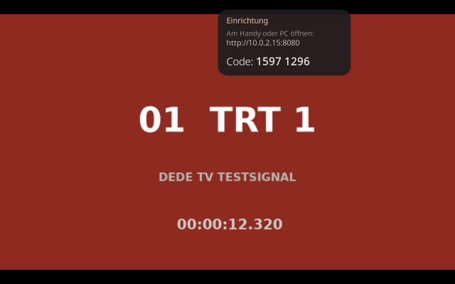 | 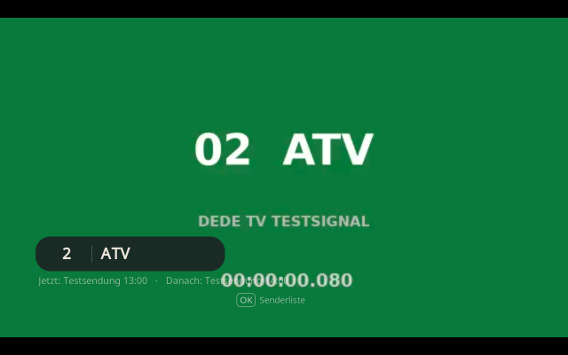 |
| **Nach dem Einschalten** läuft sofort Sender 1. Solange die Verwaltung nicht eingerichtet ist, steht oben die Adresse und der Einrichtungscode. | **Senderwechsel** mit Programm hoch/runter: Unten erscheint kurz Nummer, Name, was jetzt läuft und was danach kommt. |
| 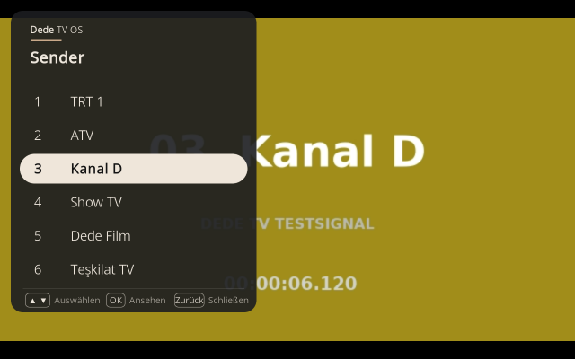 | 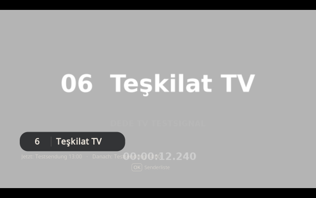 |
| **OK** öffnet die Senderliste, mit Pfeiltasten auswählen, OK schaltet um, Zurück schließt sie. | **Ziffern** schalten direkt auf den Sender. |
| 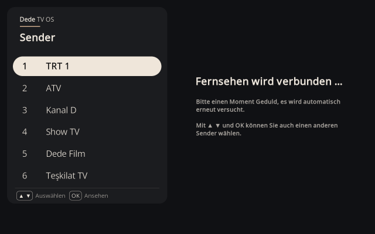 | 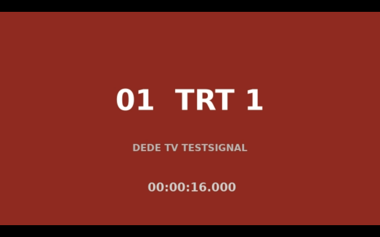 |
| **Fällt das Internet aus**, erklärt der Fernseher das in ruhigen Worten und versucht es selbst weiter. | **Ist die Verbindung zurück**, läuft der Sender von allein wieder. |
|  |  |
| **Eigener Sender** aus eigenen Filmen, mit Programmführer (jetzt/danach). | Am Ende eines Films folgt **automatisch der nächste**. |
|  | 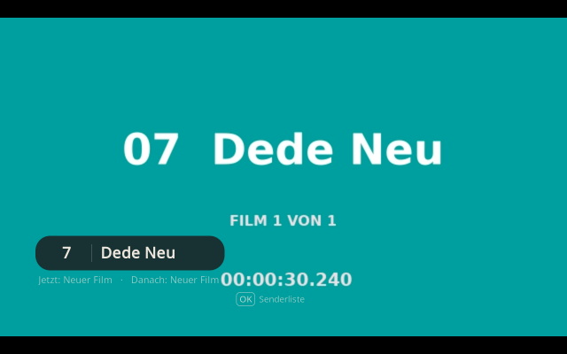 |
| **Wie echtes Fernsehen**: Wer kurz umschaltet und zurückkommt, sieht, was inzwischen läuft. | **Sender 7** wurde gerade am Handy angelegt und an den Fernseher geschickt. |
| 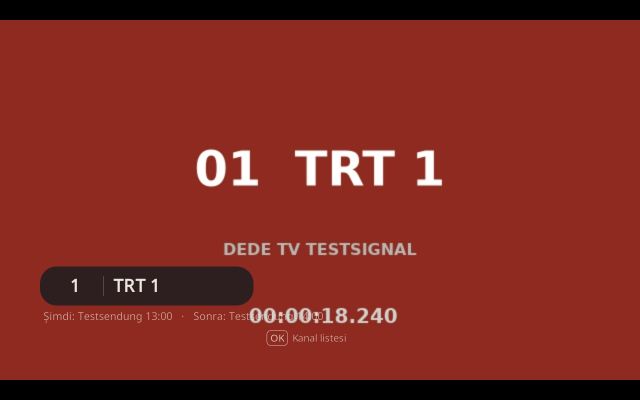 | |
| **Türkische Oberfläche** (unten „Şimdi … Sonra“) nach Umstellen in der Verwaltung, dazu eine neue Senderliste aus der Verwaltung. | |

## Verwaltung (Handy oder PC im Heimnetz)

| | |
|---|---|
| 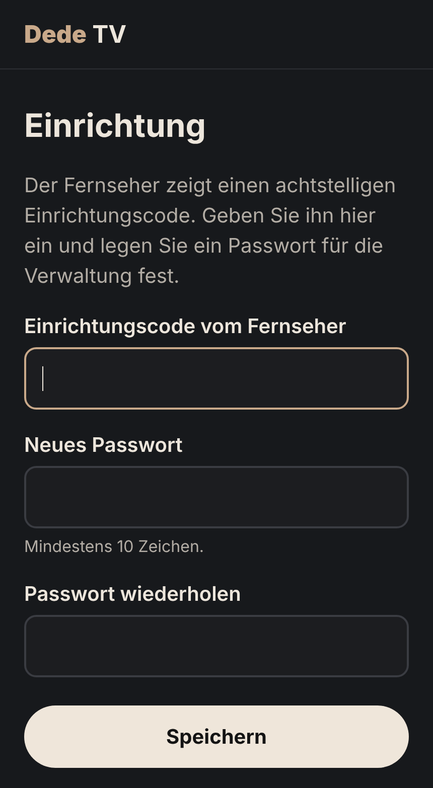 | 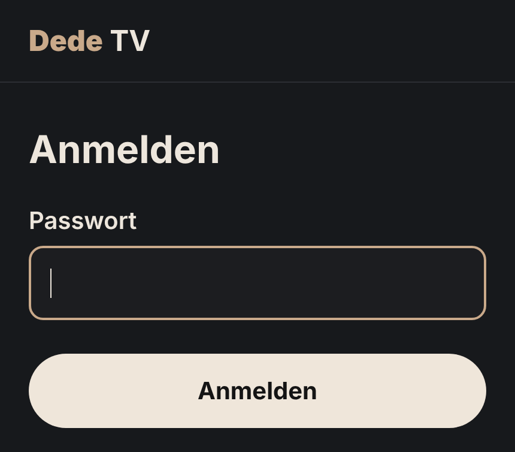 |
| **Ersteinrichtung**: Der Code steht auf dem Fernseher. Danach wird ein eigenes Passwort vergeben, es gibt kein Standardpasswort. | **Anmeldung** mit diesem Passwort. |
| 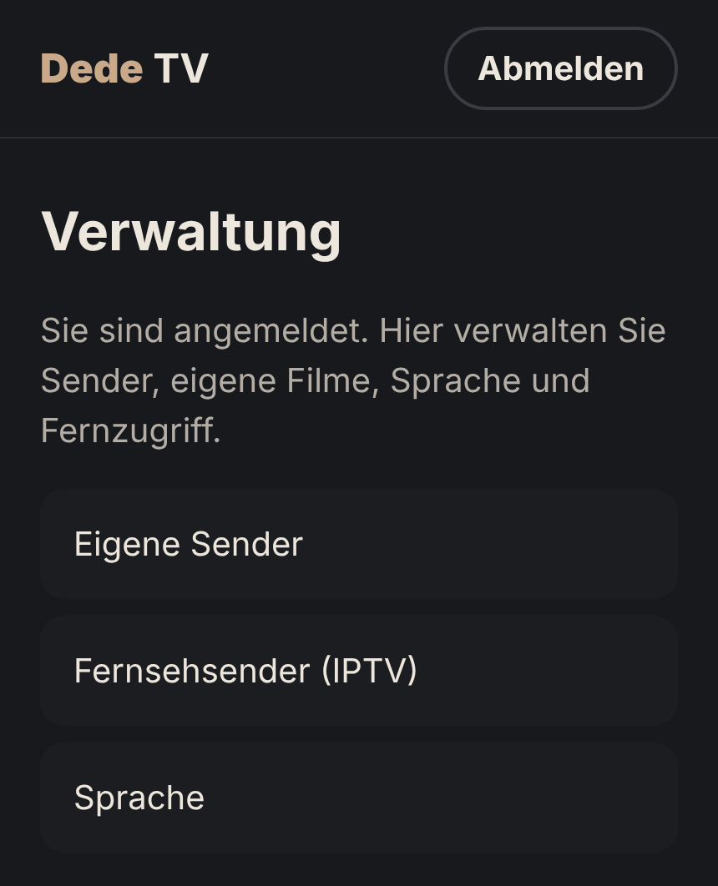 | 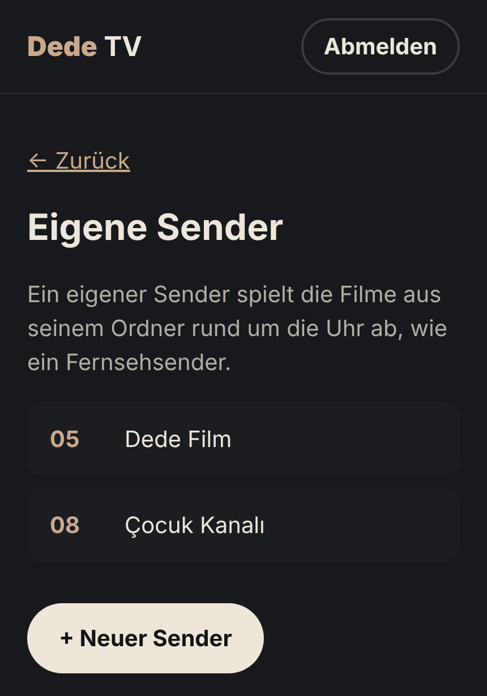 |
| **Startseite** mit großen Schaltflächen für jede Aufgabe. | **Eigene Sender**: Liste mit Nummer und Farbe. |
| 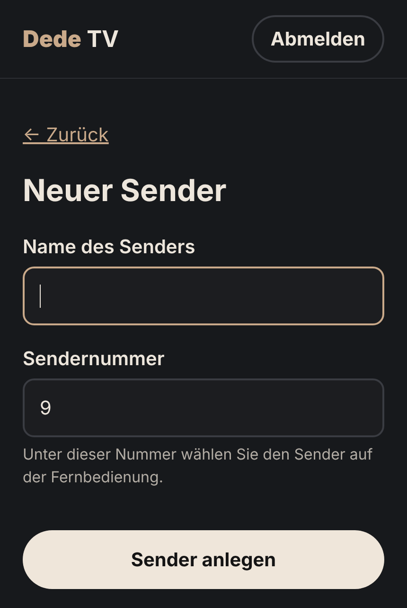 | 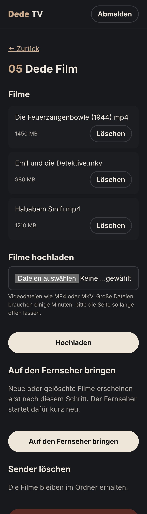 |
| **Neuer Sender**: Name, Nummer und Farbe auswählen. | **Filme hochladen** und die Reihenfolge festlegen. |
| 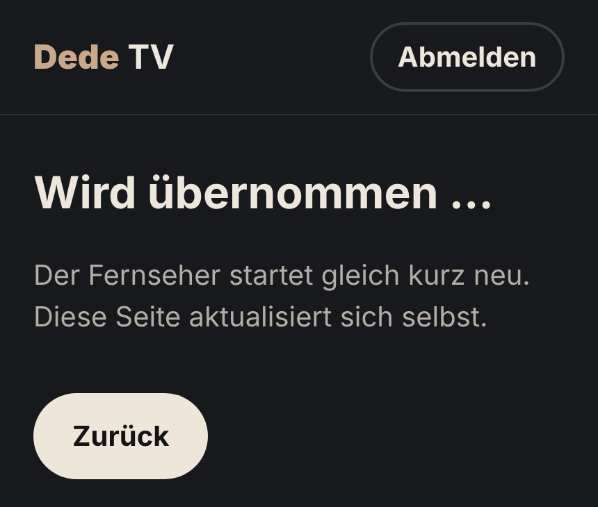 | 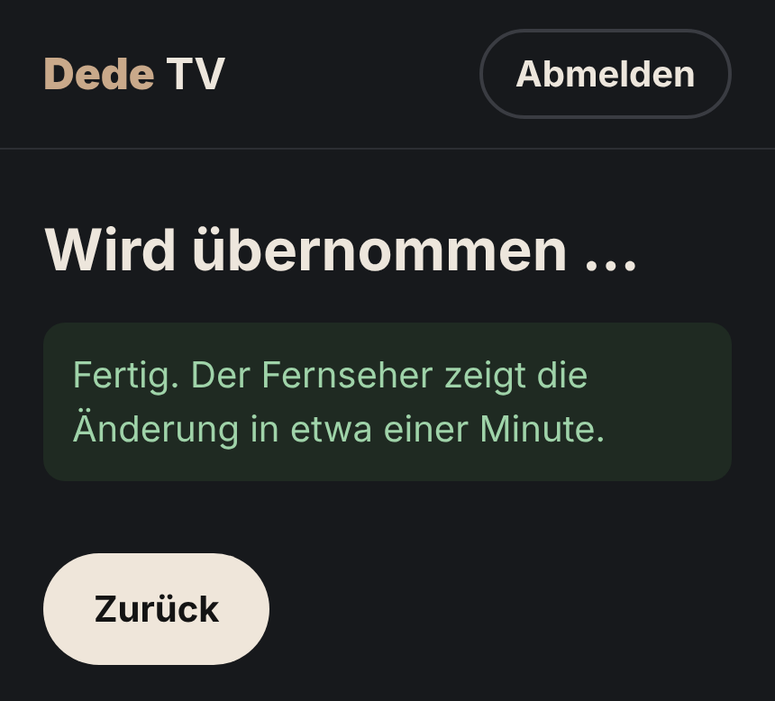 |
| **An den Fernseher senden**: Die Seite zeigt, dass gerade übertragen wird … | … und bestätigt, wenn der Fernseher fertig ist. |
| 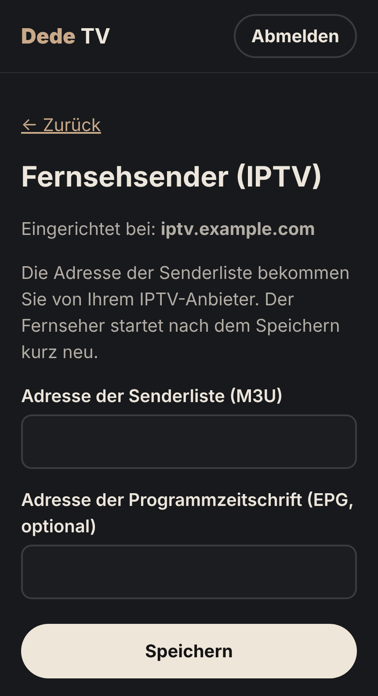 | 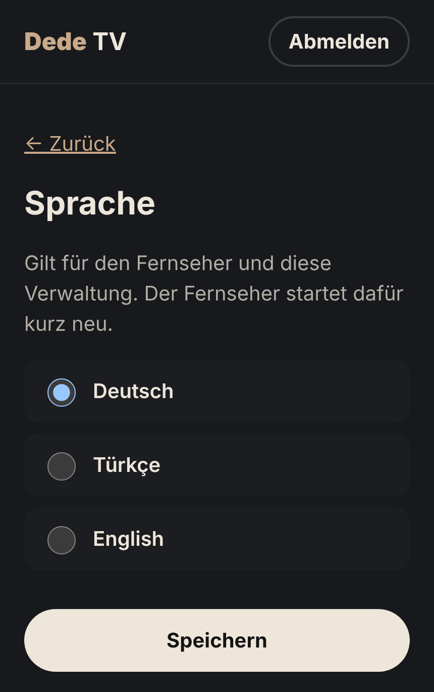 |
| **Senderliste (IPTV)**: Adresse der Senderliste und des Programmführers ändern. | **Sprache** des Fernsehers: Deutsch, Türkisch oder Englisch. |
| 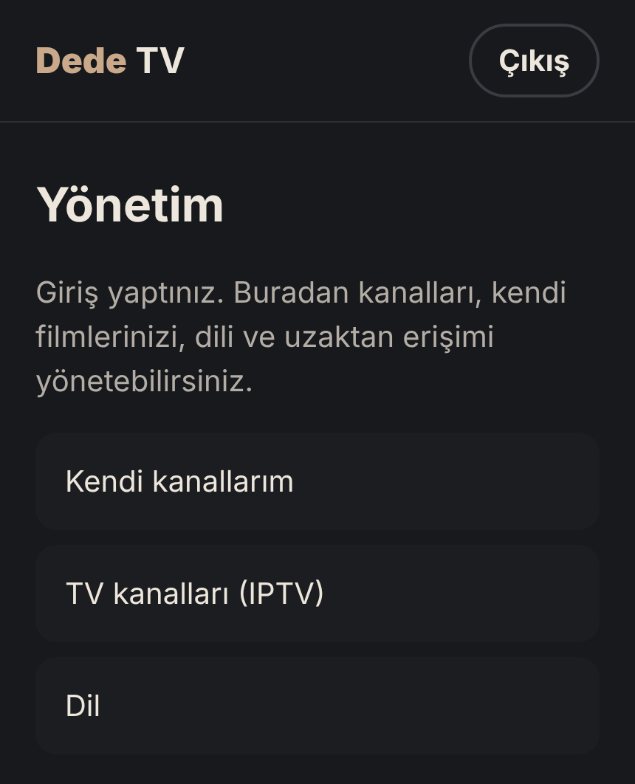 | 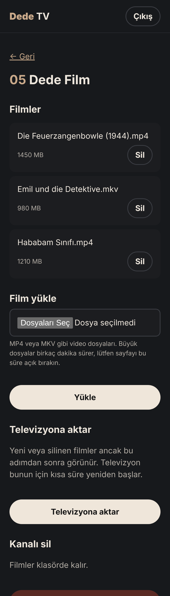 |
| Startseite auf **Türkisch**. | Filmliste auf **Türkisch**. |
